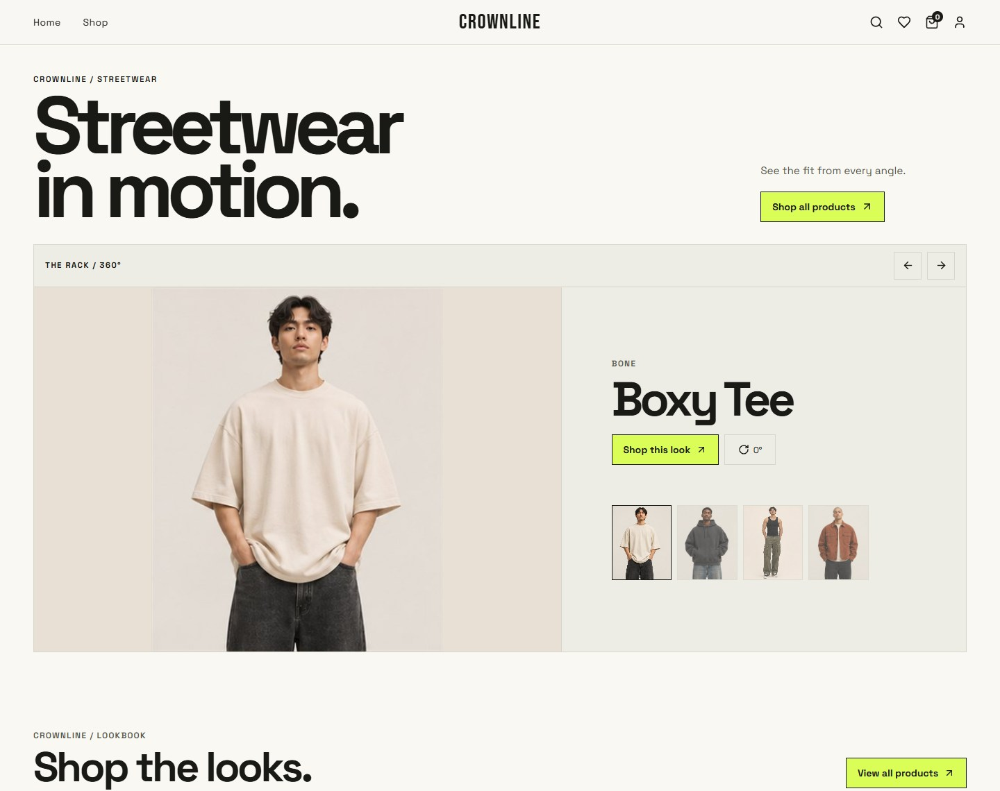

# Crownline — Streetwear E-commerce

Crownline là website thương mại điện tử thời trang streetwear nam. Trang chủ giới thiệu các bộ đồ qua ảnh người mẫu nhiều góc trong **The Rack 360°**. Mỗi bộ xoay một vòng trước khi slider chuyển sang mẫu tiếp theo, và người xem có thể mở thẳng trang sản phẩm.

- **Khách hàng** có thể tìm và lọc sản phẩm, chọn màu và size theo tồn kho, lưu sản phẩm yêu thích, đặt hàng và theo dõi giao hàng. Checkout hỗ trợ COD và VNPay.
- **Nhân viên và admin** quản lý danh mục, tồn kho, đơn hàng và tài khoản theo quyền được cấp.
- **Kiến trúc** gồm frontend React/TypeScript chạy với Vite và API Express dùng MongoDB. Có thể nạp danh mục mẫu bằng lệnh `npm run seed:lookbook` trong thư mục `backend`.

